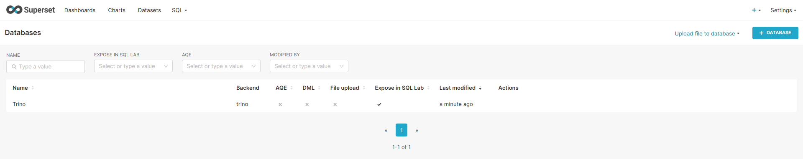
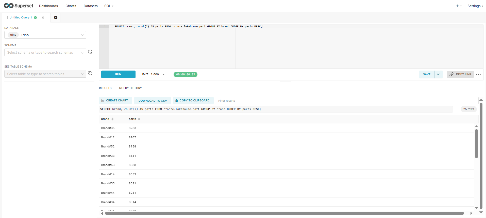

# Практическая №1 — Lakehouse + медальон, вариант 4 (Q16 «Parts/Supplier Relationship»)

## 1. Вариант и масштаб

| Поле | Значение |
|---|---|
| ФИО | Тушинов Галсан Чингисович |
| Вариант | 4 — TPC-H Q16 |
| Масштаб `sfN` | **sf1** |
| Почему выбрал такой масштаб | Q16 использует только `part` (200 тыс. строк), `partsupp` (800 тыс.) и `supplier` (10 тыс.) — это самые «лёгкие» таблицы TPC-H. На sf1 весь стек поднимается и все слои строятся за секунды-минуты на обычном ноутбуке, а данных достаточно, чтобы увидеть работу джойна, `NOT IN` и `count(DISTINCT)`. Масштаб одинаковый на всех слоях (sf1). Более крупный sf10 дал бы заметнее разницу кодеков, но потребовал бы в 10 раз больше RAM/диска без новых выводов для этого запроса. |

## 2. Поднятые сервисы — и почему именно они

Всё описано в [`docker-compose.yml`](docker-compose.yml) и поднимается одной командой `docker compose up -d`.

| Сервис | Роль в стеке | Почему именно он (а не альтернатива) |
|---|---|---|
| MinIO (форк Silo, `pgsty/silo`) | S3-совместимое объектное хранилище, сюда физически падают parquet-файлы | S3-API — стандарт, любой движок (Trino, Spark, Doris) умеет читать оттуда, то есть данные не привязаны к одному вендору. Работает локально без облака и бесплатно. Официальные образы MinIO больше не раздаются свободно, поэтому взят свободный форк с тем же API. |
| PostgreSQL 17 | БД, где Lakekeeper хранит метаданные каталога | Lakekeeper нужна транзакционная БД для списка таблиц и ссылок на метаданные; Postgres — открытый, надёжный и официально поддерживается Lakekeeper. Тяжёлый кластер для этой роли не нужен. |
| Lakekeeper | Iceberg REST Catalog — каталог метаданных таблиц | Реализует открытый REST-протокол Iceberg, поэтому каталог не зависит от движка: к нему можно подключить Trino, Spark, Superset и т.д. Лёгкий (один бинарник), в отличие от Hive Metastore, не требует Hadoop. Даёт отдельные warehouse под каждый слой медальона. |
| Trino 476 | SQL-движок: ходит в Lakekeeper за метаданными и читает/пишет данные в MinIO | Движок с MPP-архитектурой, быстрый на аналитических джойнах и агрегациях, ANSI-SQL; встроенный коннектор `tpch` генерирует данные для лабы, коннектор Iceberg поддерживает снапшоты, schema evolution и `rollback_to_snapshot`. |
| Apache Superset | BI-дашборд поверх Bronze (п. 6.2) | Открытый исходный код, подключение к Trino через SQLAlchemy-драйвер, есть SQL Lab для запросов и построение чартов без кода (подробнее в п. 6.2). |

### Скрипты, которыми поднимал стек

```bash
docker compose up -d                       # minio, postgres, lakekeeper, trino + одноразовые init-контейнеры
docker compose logs lakekeeper-init        # bootstrap: 204, warehouse bronze/silver/gold: 201
docker compose --profile bi up -d --build  # + Superset (п. 6.2)
docker ps                                  # проверка
```

| Файл | Что делает |
|---|---|
| `docker-compose.yml` | описывает все контейнеры и том `minio-data`/`pg-data` |
| `init/init-lakekeeper.sh` | принимает Terms of Use, регистрирует 3 warehouse `bronze`/`silver`/`gold` (каждый — свой бакет в MinIO) |
| `catalog/{bronze,silver,gold}.properties` | Iceberg-каталоги Trino, по одному на warehouse |
| `catalog/tpch.properties` | источник тестовых данных (встроенный генератор TPC-H) |

## 3. Разбор запроса — какие данные нужны

Q16 считает, сколько разных поставщиков может поставить деталь каждой комбинации `brand`/`type`/`size`, исключая поставщиков с жалобами.

| Таблица TPC-H | Нужные колонки | Что запрос с ними делает |
|---|---|---|
| `part` | `partkey`, `brand`, `type`, `size` | `partkey` — ключ джойна; `brand <> 'Brand#45'`, `type NOT LIKE 'MEDIUM POLISHED%'`, `size IN (...)` — фильтры; `brand, type, size` — группировка и вывод |
| `partsupp` | `partkey`, `suppkey` | `partkey` — джойн с `part`; `suppkey` — исключается через `NOT IN` и подсчитывается `count(DISTINCT suppkey)` |
| `supplier` | `suppkey`, `comment` | подзапрос: поставщики, у которых `comment LIKE '%Customer%Complaints%'`, исключаются из результата |

Остальные колонки (`name`, `mfgr`, `container`, `retailprice`, `availqty`, `supplycost`, `address`, ...) запросу не нужны.

## 4. Медальон — решения по каждому слою

Схема во всех слоях — `lakehouse`; каждый слой — свой warehouse в Lakekeeper, свой бакет в MinIO и свой каталог в Trino. Цифры получены скриптом [`sql/06_stats.sql`](sql/06_stats.sql).

### Bronze (сырой) — `sql/02_bronze.sql`

| Таблица | Колонки (что оставил) | Строк | Вес, МБ | Формат | Сжатие | Партиционирование | Обоснование |
|---|---|---|---|---|---|---|---|
| `bronze.lakehouse.part` | все 9 (как в источнике) | 200 000 | 4,2 | PARQUET | ZSTD | нет | Bronze — сырой слой «как пришло», поэтому колонки не режу: любое будущее требование можно пересчитать с нуля. Parquet колоночный, читается любым движком. ZSTD даёт степень сжатия близкую к GZIP при скорости близкой к SNAPPY (см. п. 5). Партиций нет: таблица маленькая, разбиение на sf1 лишь создало бы мелкие файлы. |
| `bronze.lakehouse.partsupp` | все 5 | 800 000 | 27,9 | PARQUET | ZSTD | нет | Тот же подход; в `partsupp` самая тяжёлая колонка — длинный текстовый `comment`, который хорошо жмётся словарём + ZSTD. |
| `bronze.lakehouse.supplier` | все 7 | 10 000 | 0,5 | PARQUET | ZSTD | нет | Справочник на 10 тыс. строк — это один небольшой файл, партиционировать бессмысленно. |

### Silver (очищенный) — `sql/03_silver.sql`

| Таблица | Колонки (что оставил) | Строк | Вес, МБ | Формат | Сжатие | Партиционирование | Обоснование |
|---|---|---|---|---|---|---|---|
| `silver.lakehouse.part_supplier` | `partkey`, `suppkey`, `brand`, `type`, `size` | 799 680 | 3,4 | PARQUET | ZSTD | нет | Здесь выполняется очистка (исключены поставщики с жалобами — аналог `NOT IN`-подзапроса) и джойн `part ⋈ partsupp`; остаются только нужные запросу 5 колонок, поэтому слой заметно легче Bronze (3,4 МБ против 27,9 МБ у `partsupp`); отброшено 320 строк `partsupp` с поставщиками-жалобщиками. Business-фильтры (`brand`, `type`, `size`) оставлены на Gold: Silver должен быть универсальной очищенной связкой, пригодной для других запросов. Партиций нет — на sf1 один файл читается быстрее, чем множество мелких. |

### Gold (витрина) — `sql/04_gold.sql`

| Таблица | Колонки | Строк | Вес, МБ | Формат | Сжатие | Партиционирование | Обоснование |
|---|---|---|---|---|---|---|---|
| `gold.lakehouse.supplier_cnt_by_part` | `brand`, `type`, `size`, `supplier_cnt` | 18 314 | 0,04 (41 043 байта) | PARQUET | ZSTD | нет | Готовый ответ на Q16: фильтры применены, агрегат `count(DISTINCT suppkey)` посчитан. Таблица совсем маленькая (результат агрегации), поэтому партиции и тонкая настройка сжатия не нужны — BI читает её мгновенно. |

Корректность Gold проверяется скриптом `sql/05_check.sql`: разность (`EXCEPT`) с эталонным запросом на `tpch.sf1` в обе стороны даёт 0 строк.

## 5. Тесты производительности

Q16 по Bronze-таблицам (`part`, `partsupp`, `supplier`), пересозданным с разным кодеком (`sql/perf/`). Запрос выполнен 5 раз подряд на каждом кодеке; в таблице — медиана последней серии (в предыдущей серии из 5 прогонов результат тот же по направлению: GZIP 627 мс, ZSTD 577 мс). Времена взяты из `system.runtime.queries`.

| Сжатие на Bronze | Время запроса (медиана, мс) | Прогоны (мс) | Размер Bronze, МБ | Вывод (что лучше и почему) |
|---|---|---|---|---|
| GZIP | 621 | 615, 623, 621, 628, 603 | 29,5 | Самый маленький размер (на ~9% меньше ZSTD), но запрос не быстрее: распаковка GZIP тратит больше CPU. Запись тоже самая медленная (`partsupp` создавалась 7,8 с против 3,6 с у ZSTD). |
| ZSTD | 499 | 499, 459, 584, 444, 592 | 32,5 | Размер почти как у GZIP (+3 МБ), зато запрос примерно на 20% быстрее, а запись более чем вдвое быстрее. Лучший компромисс — поэтому ZSTD выбран для всех слоёв. |

**Вывод.** На моём объёме (sf1, Bronze ≈ 30 МБ) разница по времени чтения небольшая (ZSTD в разных прогонах от 444 до 592 мс), а вот разница в скорости записи и в размере заметна и воспроизводима. GZIP имеет смысл для архивных данных, которые читают редко; для данных, с которыми работает аналитика, ZSTD выгоднее.

Времена брались из истории запросов Trino (по ней видно время самого запроса, без запуска CLI). Замер снаружи через `docker exec` не использовался для выводов: он включает ~2 с запуска CLI и не различает кодеки (≈2,7 с в обоих случаях).

## 6. Часть 2 — осмысление и работа с инструментами

### 6.1. Понять и объяснить

| Вопрос | Ответ |
|---|---|
| Зачем нужны большие данные и lakehouse (а не обычная БД/хранилище)? | данные не помещяютя в обычном бд, хранение эфективно в объектном хранилище, открытые форматы из за которых нет привязи в вендору, витрины и сырые данные находятся в одном месте. |
| Пример schema evolution на Silver: добавил/переименовал колонку — что произошло? | Скрипт `sql/20_schema_evolution.sql`. Добавил колонку `loaded_at`: у всех существующих строк в ней `NULL`, а файлы данных не переписывались — изменились только метаданные. Переименовал `size → part_size`: старые файлы читаются без проблем (значения 23 на месте), потому что Iceberg хранит колонки по ID, а не по имени. Затем вернул имя `size` и удалил `loaded_at`, чтобы витрина и запросы не сломались; итоговая схема — те же 5 колонок. |
| Пример скрипта восстановления данных из снапшота (time travel) | см. ниже |

**Time travel.** Сценарий: из Silver по ошибке удалены все строки бренда `Brand#11`. Скрипты: [`sql/30_time_travel_setup.sql`](sql/30_time_travel_setup.sql) (смотрим снапшоты, «ломаем» таблицу) и [`sql/31_time_travel_restore.sql`](sql/31_time_travel_restore.sql) (читаем прошлую версию через `FOR VERSION AS OF <id>` и откатываем таблицу процедурой `rollback_to_snapshot`). Результат: до удаления 799 680 строк, после `DELETE` бренда `Brand#11` — 768 194 (удалено 31 486 строк), после `rollback_to_snapshot` на снапшот `8996806472415515625` — снова 799 680. Из истории снапшотов видно, что `DELETE` создал новый снапшот (`delete`), а исходный (`append`) остался доступен для чтения и отката.

### 6.2. Подключить инструмент к lakehouse

| Инструмент | Почему выбрал именно его |
|---|---|
| Apache Superset (BI) | Открытый, лёгко ставится в Docker, умеет Trino через SQLAlchemy-драйвер, поэтому читает Bronze напрямую через тот же Lakekeeper/MinIO, что и остальной стек. Есть SQL Lab (быстро проверить, что данные видны) и конструктор чартов. Альтернативы: Metabase требует стороннего драйвера Trino, Spark/Doris — это ещё один тяжёлый движок, а для задачи «посмотреть Bronze и построить график» BI достаточно. |

**Скрипты развертывания:** сервис `superset` в [`docker-compose.yml`](docker-compose.yml) (профиль `bi`) + [`superset/Dockerfile`](superset/Dockerfile) (ставит драйвер `trino`).

```bash
docker compose --profile bi up -d --build
# UI: http://localhost:8088   логин admin / пароль admin
```

**Мои действия в UI:**

1. Settings → Database Connections → **+ Database** → Trino.
2. SQLAlchemy URI: `trino://trino@trino:8080/bronze` → Test Connection → Connect.
3. SQL Lab → база `Trino`, запрос:
   ```sql
   SELECT brand, count(*) AS parts
   FROM bronze.lakehouse.part
   GROUP BY brand ORDER BY parts DESC;
   ```
4. Результат: запрос выполнился за 0,32 с и вернул 25 строк — по одной на каждый бренд (`Brand#11` … `Brand#55`), то есть Superset читает таблицу Bronze через Trino → Lakekeeper → MinIO.

Подключение Trino в списке баз Superset:



Запрос по Bronze в SQL Lab:



## 7. Выводы

Медальон физически разделяет сырые данные, отдельные бакеты и каталоги, так что Gold можно пересобрать из Bronze, Parquet + ZSTD компромисс между размером и скоростью, на sf1 партиционирование не нужно, так как приводит к мелким файлам.
